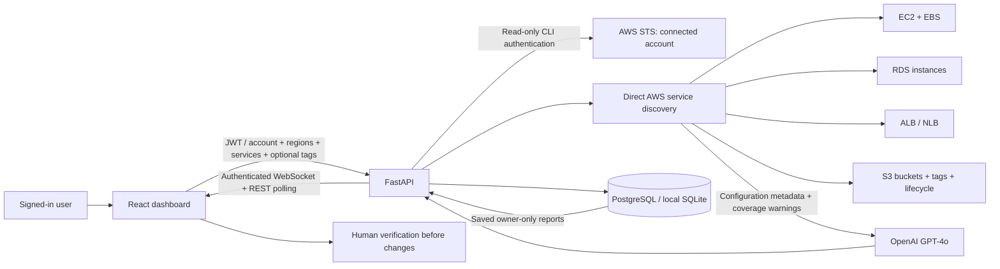

# AI Cloud Cost Detective — Current Architecture

No AWS Resource Group is required. AWS identity comes from the backend role/profile; entering an account ID does not grant access or switch accounts. AWS API calls use argument lists without a shell and never mutate resources. Only selected metadata is sent to OpenAI.

Billing, utilization, pricing, realized savings, and automated remediation are not integrated. S3 bucket configuration is collected without reading object contents; storage quantities and request costs remain unknown. Reports identify partial discovery failures and missing evidence. Historical uploaded specifications and `docs/images/cloud-cost-detective-workflow.png` describe the earlier Resource Group design.
